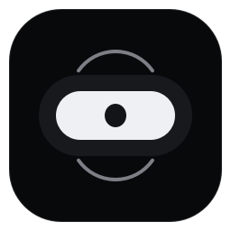

<div align="center">
  
  <h1>WinIsland</h1>
  <p><strong>A lightweight, matte-black Dynamic Island for Windows.</strong></p>
  <p>Media, system status, quick controls, calendar and tasks in one compact desktop companion.</p>
  <p>Turkish and English interface · Designed for Windows 10 and 11</p>

  <p>
    
    
    
    <a href="LICENSE"></a>
  </p>
</div>

WinIsland is an open-source Windows desktop companion built around a compact, animated island. It provides media controls, system status, quick actions, calendar and productivity tools in a quiet, low-overhead interface.

## Features

- Compact capsule with media and system indicators
- Horizontal notification banners for battery, device, recording and other events
- Horizontal hover preview with clock, battery, weather, task summary and CPU/RAM status
- Click to open the dashboard; scroll to move between pages
- Calendar and locally stored to-do list with scrollable tasks and working checkmarks
- Media playback, seeking, volume and mute controls
- Control Center with volume, brightness and Windows quick settings shortcuts
- Battery, CPU and memory status, weather and a live clock
- Focus timer, AI quick ask, clipboard watcher, file pocket and Pixel companion
- System tray controls, optional startup launch, configurable notifications and status indicators
- Turkish and English interface with live language switching

## Interaction

| Gesture | Action |
| --- | --- |
| Hover over the compact capsule | Opens a short horizontal preview; it collapses when the pointer leaves |
| Click the capsule | Opens the full dashboard; it collapses when the pointer leaves |
| Scroll over the island | Opens the dashboard or moves between its pages |
| Scroll over Calendar & Tasks | Scrolls the task list without changing dashboard pages |
| Battery, system or app event | Preserves the separate horizontal notification animation |

The interface uses a matte near-black surface, bold Segoe UI typography and monochrome vector icons. It contains no emoji in the user interface.

## Run from source

```powershell
python -m pip install -r requirements.txt
python main.py
```

## Build the Windows installer

See [packaging/README.md](packaging/README.md) for build instructions. The bilingual setup wizard includes a localized introduction, the MIT license page and a checked-by-default option to launch WinIsland when setup finishes. The language selected during setup becomes the app's default language on a fresh install; existing user preferences are preserved on upgrades.

The application stores settings and task data under `%APPDATA%\WinIsland` when installed. Running from source keeps configuration and task data in the repository.

## Project layout

- `core/` — island window, behavior, dimensions and animation
- `ui/` — dashboard, calendar, controls and settings
- `modules/` — Windows integrations and background workers
- `assets/` — application icon and installer artwork
- `installer/` — Inno Setup configuration
- `data/` — local task data when running from source

The WinIsland IPC endpoint is used by default. The former endpoint remains accepted for existing notification scripts.
